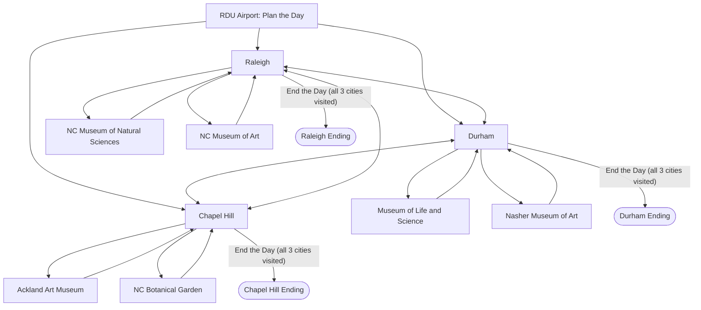

# [Tony Takes a Trip To The Triangle]

> WEB-115 Final Project: Interactive Browser Story
> **Live site (GitHub Pages):** [link here]
> **Repository:** https://github.com/achunter3/WEB-115-Final-Project

---

## 1. Team Members and Roles

| Name                    | GitHub Username | Responsibilities        | Git Branch     |
|-------------------------|-----------------|-------------------------|----------------|
| Aaron Hunter            | @achunter3      | Story writing, README, Feature deveopment   | development-AH |
| Asante Malik Boler      | @taedadev       | Styling, Imagry, Story  | deveopment-AB  |
| Taylor James Remington  | @tremington1k   | HTML, Base JS Functionality | deveopment-TR  |

**How we communicated:** 
- Email
- Blackboard
- Microsoft Teams (Messenger and Voice)
---

## 2. Genre Blend

- **Genre chosen by [Aaron & Asante]:** [Informational + Adventure]

---

## 3. Application Overview

### Story Summary
- Starting point:
  - Tony is taking a trip to the Triangle. He is on a mission to learn about the cities that make up the triangle and visit as many museums as possible.

### Gameplay
The player will use directional buttons to cycle through options (such as moving locations). Once the player gets to a location, they will be given information about the place and given a puzzle or riddle to solve. Once they get the solution they will be given a stamp for the location, marking it complete. 

### Endings
The player must visit and get a stamp at least one museum in each city before they can end the day. The ending depends on which city they are in when they end it.
1. **Raleigh Ending:** Night Skyline of Raleigh
2. **Durham Ending:** Night Skyline of Durham 
3. **Chapel Hill Ending:**  Night Skyline of Chapel Hill

---

## 4. Story Flowchart

> Requirement: **at least 13 nodes**

**Core rule:** The player can travel freely between Raleigh, Durham, and Chapel Hill. The **End the Day** button is locked until the player has visited at least one museum in each city. Once it unlocks, the city the player is in when they end the day decides the ending.

### Scene List (planning helper)
| Node ID | Scene Name | City | Image File | Choices / Exits | Feature ideas | Who's writing it |
|---------|------------|------|------------|-----------------|---------------|------------------|
| START | RDU Airport: Plan the Day | — | | Raleigh, Durham, Chapel Hill | Default image (map of the Triangle) | |
| RAL | Raleigh (city hub) | Raleigh | | Natural Sciences, NC Museum of Art, travel to Durham / Chapel Hill, End the Day | | |
| NS | NC Museum of Natural Sciences | Raleigh | | Back to Raleigh | | |
| NCMA | NC Museum of Art | Raleigh | | Back to Raleigh | | |
| DUR | Durham (city hub) | Durham | | Life and Science, Nasher, travel to Raleigh / Chapel Hill, End the Day | | |
| MLS | Museum of Life and Science | Durham | | Back to Durham | | |
| NAS | Nasher Museum of Art | Durham | | Back to Durham | | |
| CH | Chapel Hill (city hub) | Chapel Hill | | Ackland, Botanical Garden, travel to Raleigh / Durham, End the Day | | |
| ACK | Ackland Art Museum | Chapel Hill | | Back to Chapel Hill | | |
| BOT | NC Botanical Garden | Chapel Hill | | Back to Chapel Hill | | |
| E1 | Raleigh Ending | Raleigh | | Night Skyline of Raleigh | | |
| E2 | Durham Ending | Durham | | Night Skyline of Durham | | |
| E3 | Chapel Hill Ending | Chapel Hill | | Night Skyline of Chapel Hill | | |

---
